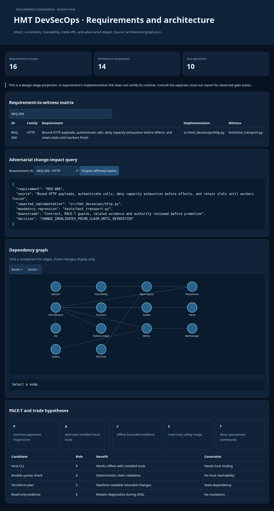
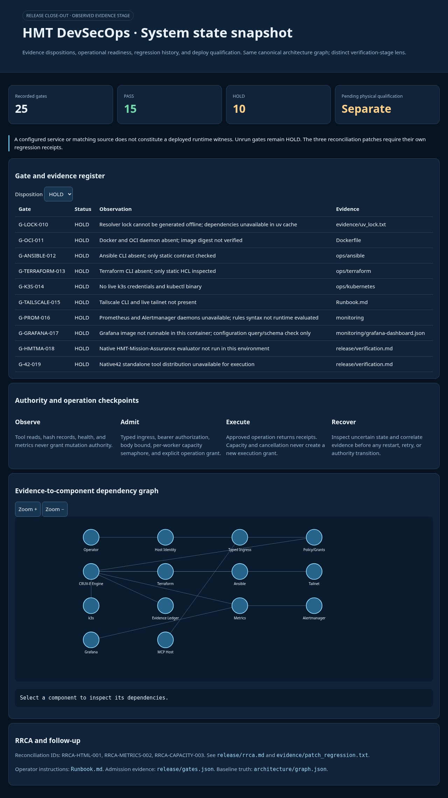

# HMT DevSecOps Tools

   

A governed, reproducible lab maintenance and infrastructure reference for Linux, Terraform, Ansible, Tailscale, and k3s. Human approval governs consequential changes. Telemetry never creates authority.

[Operator SOP](Runbook.md) · [Agent instructions](AGENTS.md) · [Architecture and Requirements](HMT_DevSecOps_Requirements_v1.0.0.html) · [Close-out View](HMT_DevSecOps_Closeout_v1.0.0.html)

## How it works
Operator identity → bounded tool contract → policy check → inspection or immutable proposal → evidence → human action. Ten fixed tools provide CRUV-E and five operational paths. A safe API and stdio server share the same evaluator. The original hand sketches are preserved under `references/drafts/` without runtime authority.

## Change the policy

Start with [`examples/hmt_policy.toml`](examples/hmt_policy.toml). Declare the rule in TOML. Run admission. If the rule is new, add its typed model and bind it to the operation that owns the effect. Run the same witness again and compare the result with the rule.

The engine uses `tomllib` and rejects unknown keys, bad types, and unsafe paths. It hashes the exact admitted bytes. Tool results, immutable proposals, and rendered Compose configuration carry the digest.

Use `--policy` for the CLI and MCP server. HTTP admits one policy and its protected credential files at startup. Keep approval and bearer values out of TOML, environment variables, and evidence. The existing JSON-RPC contract and ten tools still govern execution. [Operator steps](Runbook.md)

## Verified interface captures

## Evidence
The linked HTML reports distinguish executable software proof from deployment-only checks. Screenshot evidence must be captured from real execution; no synthetic screenshots are supplied as release proof. HA, cluster resiliency, and multi-node behavior are design concerns until host-based qualification.

## Qualification

Forgejo runs the locked Linux suite with the 90% coverage floor, starts real CLI, stdio, and HTTP processes for the policy witness, and builds the wheel. The witness preserves the TOML, proposal, Compose artifact, and receipts. [Forgejo workflow](.forgejo/workflows/policy.yml)

The requirements graph, screenshots, and gate reports describe the original 1.0.0 release. [Historical evidence](release/verification.md)
